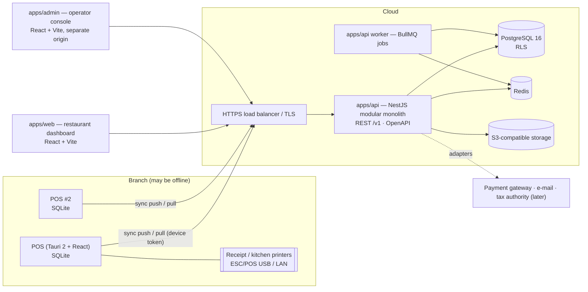

# 02 — Architecture

Status: **Phase 1 draft for review**. Decisions are recorded as ADRs in [`adr/`](adr/).

## 1. System context


## 2. Repository layout (created in Phase 2)
```
restaurant-os/
├─ apps/
│  ├─ api/                 NestJS 11 — HTTP API + worker entry (same codebase, two processes)
│  │  ├─ prisma/           schema.prisma, SQL migrations (RLS, triggers, check constraints), seed
│  │  ├─ src/platform/     tenancy, plans, subscriptions, operator auth, support sessions
│  │  ├─ src/identity/     users, sessions, roles, permissions, devices, audit
│  │  ├─ src/setup/        branches, warehouses, tables, printers, taxes, payment methods, settings
│  │  ├─ src/catalog/      categories, products, variants, modifiers, prices, catalog versions
│  │  ├─ src/sales/        orders, invoices, payments, refunds, cash sessions, approvals
│  │  ├─ src/sync/         push/pull endpoints, operation handlers registry, diagnostics
│  │  ├─ src/inventory/    items, units, recipes, movements, balances, counts, transfers, production
│  │  ├─ src/purchasing/   suppliers, quotations, POs, GRNs, supplier invoices/payments/returns
│  │  ├─ src/accounting/   COA, periods, journals, posting engine, reconciliation, statements
│  │  ├─ src/people/       employees, shifts, attendance, leave, payroll
│  │  ├─ src/customers/    customers, loyalty, coupons, promotions
│  │  ├─ src/kitchen/      stations, tickets
│  │  ├─ src/reporting/    read models and report queries
│  │  └─ test/             integration + e2e (real Postgres), factories
│  ├─ web/                 React 19 + Vite + Tailwind — tenant dashboard
│  ├─ admin/               React 19 + Vite + Tailwind — operator console
│  └─ pos/                 Tauri 2: src-tauri/ (Rust: SQLite, outbox, sync, printing) + src/ (React UI)
├─ packages/
│  ├─ domain/              Pure TS business rules shared by POS and API: money, rounding, tax and
│  │                       order-total calculation, unit conversion, state machines. No I/O.
│  ├─ contracts/           Zod schemas: REST DTOs and the versioned sync contract (op types, payloads)
│  ├─ ui/                  Accessible component library (Radix primitives + Tailwind, RTL-aware)
│  ├─ i18n/                ar/en dictionaries, Intl formatting helpers
│  └─ config/              shared eslint, tsconfig, prettier
├─ infra/                  docker-compose, Dockerfiles, postgres init (roles), backup scripts
├─ docs/                   this documentation
└─ .github/workflows/      CI
```

## 3. Backend module rules
- Each module exposes a **service interface** (`*.facade.ts`) — the only thing other modules may import.
  Modules never query another module's tables directly. An ESLint boundary rule enforces it.
- Layering: controller (HTTP, guards, DTO validation) → application service (use case, transaction
  boundary) → domain logic (`packages/domain` + module domain code) → repository (Prisma via `TenantTx`).
- Cross-module side effects that must be atomic (sale → stock movements → journal entry) are executed as
  **synchronous facade calls inside one database transaction** (see §5). Side effects that may lag
  (e-mail, report refresh, webhooks, KDS fan-out) are written to the `outbox_events` table in the same
  transaction and published by the worker.
- No module reads `Date.now()` or a timezone directly; it receives a `Clock` and the branch timezone.

## 4. Data flow of a sale (vertical slice)
```mermaid
sequenceDiagram
  participant UI as POS UI (React)
  participant R as POS core (Rust)
  participant DB as SQLite
  participant P as Printer
  participant API as API /v1/sync/push
  participant PG as PostgreSQL
  UI->>UI: compute totals (packages/domain)
  UI->>R: finalize_sale(order snapshot with totals)
  R->>DB: BEGIN; insert sale, lines, payments; insert outbox op; COMMIT (WAL, synchronous=FULL)
  R-->>UI: sale committed (local number BR1-D02-000123)
  R->>P: print receipt (from local data only)
  loop sync worker (backoff + jitter)
    R->>API: POST batch [op1..opN] (device token)
    API->>PG: per op: BEGIN; idempotency check; order/invoice/payment; stock movements; journal entry; audit; COMMIT
    API-->>R: per-op result {accepted|already_processed|retryable|rejected, server_ref}
    R->>DB: mark ops acknowledged / failed
  end
```
Note on totals: the order-total calculator lives in `packages/domain` (TypeScript) and runs in the POS
React layer before the Rust command persists the snapshot. The **server re-runs the same calculator**
on the persisted lines and flags any discrepancy (acceptance P3-6). Rust does not re-implement tax math.

## 5. Transaction boundaries
| Use case | Boundary (one PostgreSQL transaction) | Idempotency key |
|---|---|---|
| Ingest one sync operation `sale.finalized` | idempotency row + order + items + invoice + lines + payments + stock movements + balances + journal entry + audit + outbox events | `(tenant_id, operation_id)` |
| Ingest `refund.issued` | refund + lines + payment-out + optional stock return + reversal journal + audit | `(tenant_id, operation_id)` |
| Close cash session | session close + variance journal + audit | `(tenant_id, operation_id)` |
| Post goods receipt | GRN status + movements + balances (avg cost) + journal + audit | `Idempotency-Key` header |
| Post supplier invoice | invoice status + journal + PO match state + audit | `Idempotency-Key` header |
| Manual journal entry post | entry status + lines lock + audit | `Idempotency-Key` header |
| Approve stock count | count status + adjustment movements + journal + audit | `Idempotency-Key` header |
| Approve payroll run | run status + journal + audit | `Idempotency-Key` header |

Rules:
- Isolation level `READ COMMITTED` plus **row locks** (`SELECT … FOR UPDATE`) on `stock_balances` rows and
  document rows being transitioned; balances are locked in a deterministic order (item id, warehouse id) to
  avoid deadlocks. Serialization failures and deadlocks are retried up to 3 times by the transaction helper.
- If posting fails (e.g. missing account mapping), the **whole transaction rolls back**; the sync operation is
  recorded as `rejected` with reason `posting_mapping_missing` (retryable after fix), never half-applied.
- Every mutating HTTP endpoint accepts `Idempotency-Key`; financial ones require it.

## 6. POS internals
> **Amended by [ADR-0012](adr/0012-pos-core-in-typescript.md):** the POS business logic (orders, finalize,
> outbox, sync client, receipts) is TypeScript in `packages/pos-core` and reaches SQLite through an atomic-batch
> `SqlDriver`. Rust keeps the native parts: the SQLite file and batch executor, printing, credentials and updates.
> The bullets below describe the target runtime.

- **Tauri 2**; the Rust core owns SQLite (rusqlite, WAL, `synchronous=FULL`, `foreign_keys=ON`), the outbox,
  the sync loop and printing. The React UI calls typed Tauri commands; it never opens the DB itself.
- Local schema migrations are embedded in the binary, versioned (`PRAGMA user_version`), run in a
  transaction at start-up after an automatic file backup (`pos.db.bak-<version>`). Migration failure
  restores the backup and starts in diagnostics mode.
- Sync loop: exponential backoff `min(5 min, 2s × 2^n)` with full jitter; pauses while a sale is
  being finalized; batches up to 200 ops / 1 MB, ordered by local sequence.
- Pull: catalog/config changes since cursor, applied in one SQLite transaction per page.
- Printing: ESC/POS raw over USB (Windows spooler raw mode) or TCP 9100; template rendered locally with
  Arabic shaping (rendered to raster image for printers without Arabic code pages).
- Credentials in Windows Credential Manager (DPAPI) via the `keyring` crate; never in SQLite plain text.
- Auto-update via Tauri updater with signed releases; an update never runs while unsynced ops exist
  unless the migration path is tested for that version pair.

## 7. Web apps
- React 19 + Vite + TypeScript, TanStack Router + Query, React Hook Form + Zod (`packages/contracts`).
- Tailwind with logical properties only (`ms-`, `pe-`, …) so RTL mirrors automatically; `dir` set from locale.
- Same-origin `/api` reverse proxy in every environment so the session cookie is first-party.
- `apps/admin` is deployed on a separate hostname with its own cookie name and its own login; tenant
  sessions are not valid there.

## 8. Cross-cutting
| Concern | Approach |
|---|---|
| Config | `@nestjs/config` + Zod-validated env; app refuses to start on invalid config |
| Logging | pino JSON; fields: `request_id`, `tenant_id`, `device_id`, `operation_id`; redaction list for secrets/PII |
| Errors | `{ statusCode, code, message, details? }`, `code` is stable and translated in the UI; no stack traces in prod |
| Health | `/health/live` (process), `/health/ready` (DB, Redis); worker heartbeat in Redis |
| Metrics | OpenTelemetry → Prometheus-compatible endpoint: request latency, sync ops/sec, rejections, queue depth |
| Jobs | BullMQ queues: `outbox-publisher`, `subscription-lifecycle`, `scheduled-prices`, `reports`, `emails` |
| Files | S3 adapter (MinIO locally): product images, exports, backups manifest; signed URLs, tenant prefix |
| API | URI versioning `/v1`; OpenAPI generated from Zod via `@anatine/zod-openapi` or nestjs-zod; breaking changes → `/v2` |
| Time | All timestamps `timestamptz` UTC; business date (`business_date`) computed in branch timezone with configurable day cutoff (e.g. 04:00) |

## 9. Deployment (target)
- Containers: `api`, `worker`, `web` (static via nginx or CDN), `admin` (static). Managed PostgreSQL with
  PITR, managed Redis, S3. TLS terminated at the load balancer; HSTS.
- Environments: `dev` (docker compose), `staging`, `production`. Migrations run as a release step using
  the **owner** DB role; app runs with the restricted role.
- CI: lint, typecheck, unit, integration (Postgres + Redis services), Playwright, POS Rust tests
  (`cargo test`) on `windows-latest`, image build, SBOM + vulnerability scan.

## 10. What is reused from Agency OS
Patterns proven in the existing project (`D:\New folder (4)`) and ported, not copied blindly:
- Opaque session cookie + SHA-256 stored hash + CSRF double-submit + login throttling.
- `withTenant()` transaction helper setting a transaction-local GUC for RLS, non-superuser app role,
  `FORCE ROW LEVEL SECURITY`, same-tenant composite foreign keys, append-only audit log via `REVOKE`.
- Guard chain `Session → CSRF → Permissions → Zod pipe → service → tenant transaction → audit`.
- Consistent error format and i18n-able error codes.
Not reused: Next.js web app (stack requirement is React + Vite), agency domain modules.
