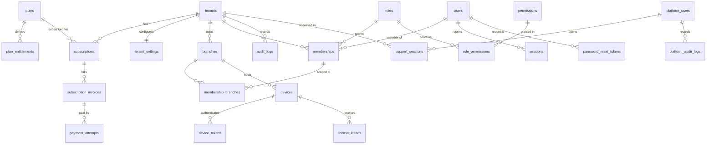
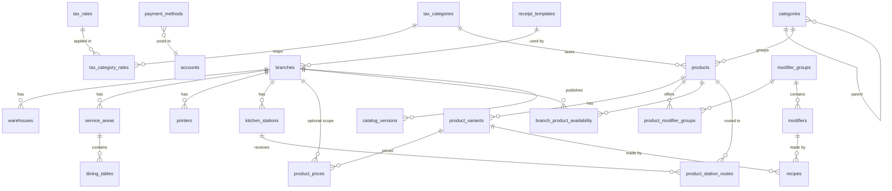
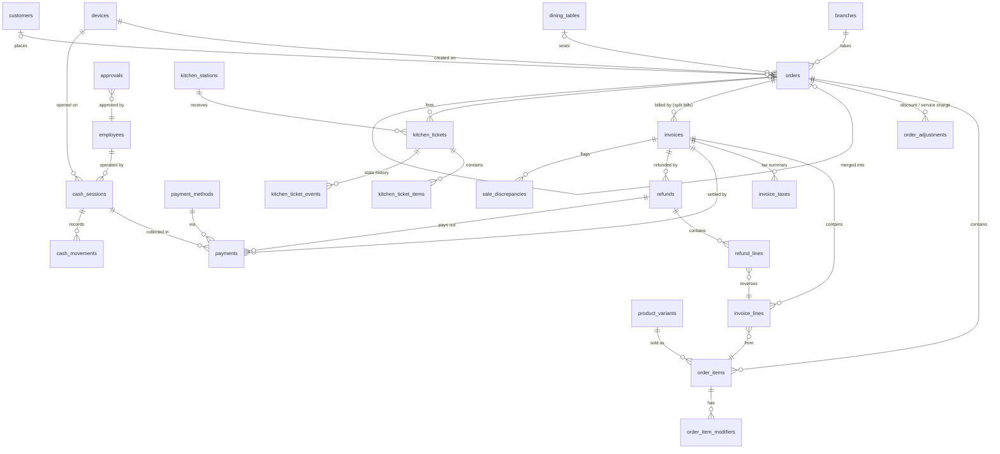
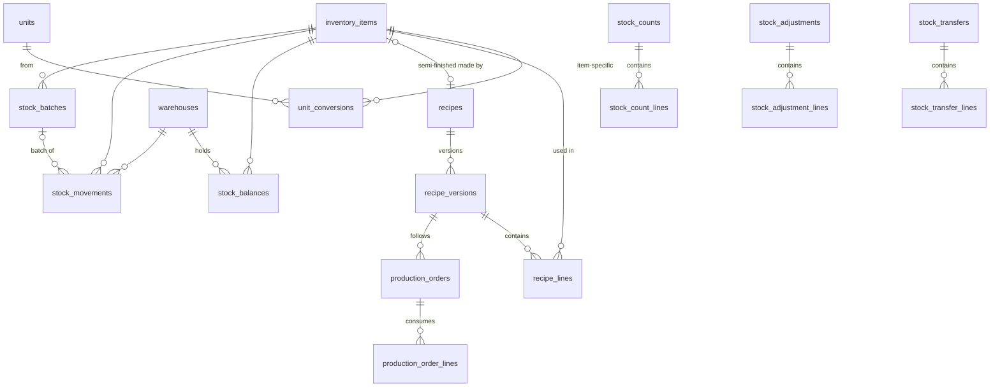
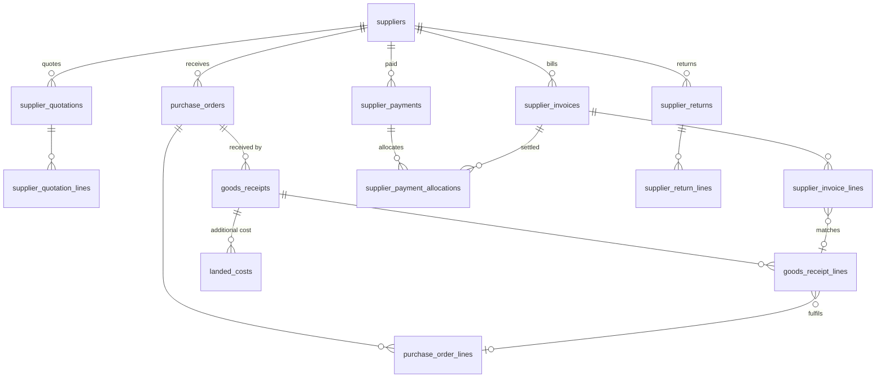
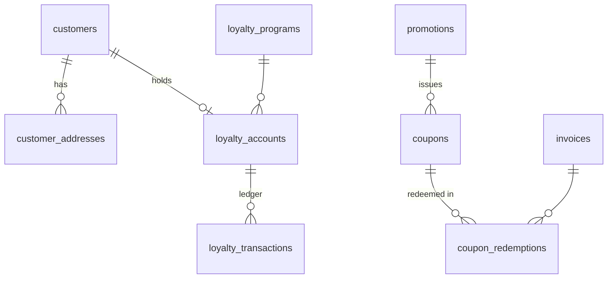
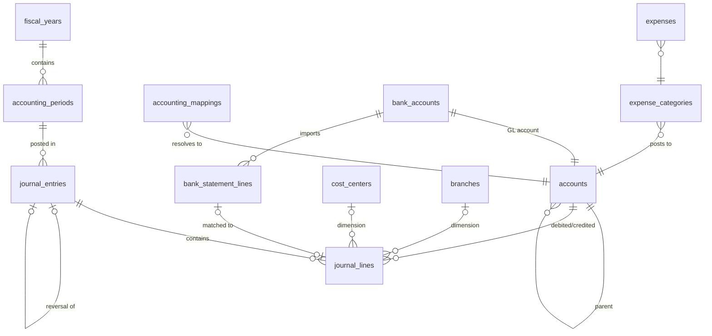
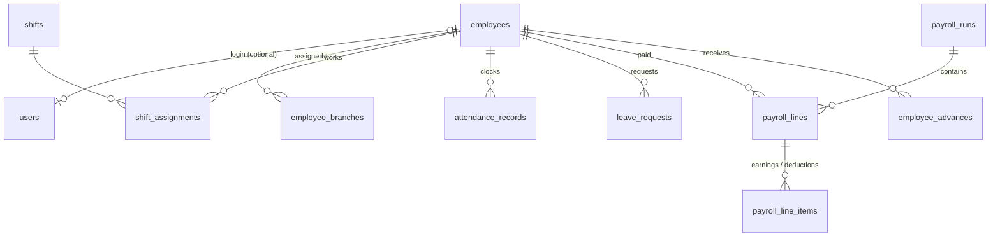
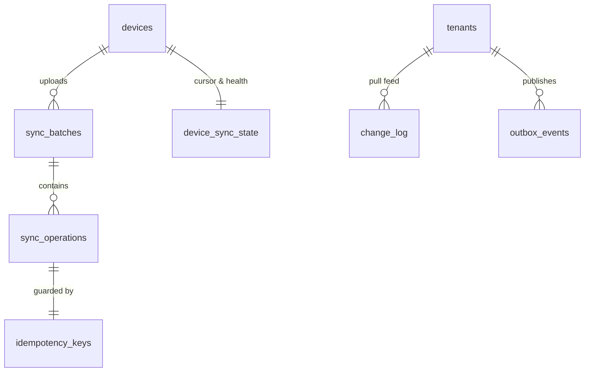

# 03 — Entity-Relationship Diagram

Split by domain for readability. Column details, constraints and states are in
[`04-data-dictionary.md`](04-data-dictionary.md). Every tenant-scoped entity carries `tenant_id` (omitted from
the diagrams below except on `tenants`); every FK between tenant-scoped tables is a composite
`(id, tenant_id)` FK (ADR-0002).

## 1. Platform, tenancy, identity

## 2. Restaurant setup and menu

## 3. POS, sales, cash, kitchen

## 4. Inventory, recipes, production

`stock_movements.source_type/source_id` point at the originating document (invoice line, refund line, goods
receipt line, adjustment line, count line, transfer line, production order, supplier return line).

## 5. Purchasing and suppliers

## 6. Customers and loyalty

## 7. Accounting

`journal_entries.source_type/source_id` link back to the operational document that produced them.

## 8. Employees and payroll

## 9. Sync and integration infrastructure

