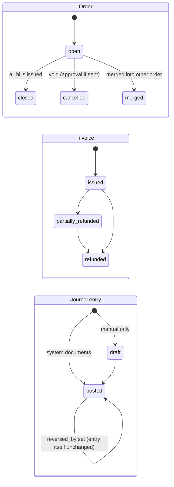

# 07 — Accounting & Inventory Rules

Status: **Phase 1 draft — requires review by a qualified accountant before production use (see §8).**

## 1. Invariants and how each is enforced
| # | Invariant | Enforcement |
|---|---|---|
| I1 | A posted journal entry has Σdebit = Σcredit > 0 | Posting service check + **deferred constraint trigger** `journal_balanced` at COMMIT |
| I2 | Journal lines have exactly one of debit/credit > 0, on postable accounts | CHECK + trigger on `accounts.is_postable` |
| I3 | Posted entries and lines are immutable | `forbid_change_when_posted` trigger; `ros_app` has no DELETE |
| I4 | Corrections only by reversal or adjusting entries | Reversal = mirror lines, `reversal_of_id`, UNIQUE one reversal per entry |
| I5 | Finalized documents cannot be silently edited or deleted | Triggers on invoices, lines, payments, refunds, GRNs, supplier invoices, counts, adjustments; status changes only via facades; every change audited |
| I6 | Retrying cannot duplicate invoices/payments/movements/entries | `idempotency_keys`; UNIQUE `(source_type, source_id, purpose)` on journals; UNIQUE source keys on stock_movements; deterministic derived ids (ADR-0005) |
| I7 | Sale + its posting are consistent and recoverable | Same DB transaction (ADR-0007); failure rolls back everything and the op is retried |
| I8 | Stock movements reconcile with balances | Balances updated only in the movement transaction under row lock; nightly + on-demand reconciliation report lists mismatches (never auto-fixes) |
| I9 | Recipe consumption reproducible | Invoice line stores `recipe_version_id`; versions immutable once active; consumption function pure (`packages/domain`) with golden tests |
| I10 | Refunds reference the original transaction | `refunds.invoice_id NOT NULL`, `refund_lines.invoice_line_id NOT NULL`, qty cap |
| I11 | Closed periods protected | Posting checks period status + permission; trigger rejects lines dated in `closed` periods; reopen requires `accounting.period_reopen`, audited |
| I12 | Reconciliation reports expose mismatches | Reports return explicit `difference` rows; there is no "force balance" action |
| I13 | Frontend totals are never authoritative | Server recomputes every document from lines; discrepancies flagged |

## 2. Document state machines

| Document | States | Permitted transitions (others rejected with `invalid_state_transition`) |
|---|---|---|
| Order | open, closed, cancelled, merged | open→closed · open→cancelled · open→merged |
| Invoice | issued, partially_refunded, refunded | issued→partially_refunded→refunded · issued→refunded |
| Cash session | open, closed | open→closed (once) |
| Purchase order | draft, pending_approval, approved, partially_received, received, closed, cancelled | draft→pending_approval→approved→partially_received→received→closed · draft/pending_approval/approved(no GRN)→cancelled · partially_received→closed (short-close, reason required) |
| Goods receipt | draft, posted, cancelled | draft→posted · draft→cancelled |
| Supplier invoice | draft, posted, partially_paid, paid, cancelled | draft→posted→partially_paid→paid · posted→paid · draft→cancelled |
| Supplier payment | draft, posted, voided | draft→posted→voided (reversal entry) |
| Stock count | draft, in_progress, submitted, approved, cancelled | draft→in_progress→submitted→approved · submitted→in_progress (rejected back) · draft/in_progress→cancelled |
| Stock adjustment | draft, posted, cancelled | draft→posted · draft→cancelled |
| Stock transfer | draft, dispatched, received, cancelled | draft→dispatched→received · draft→cancelled |
| Production order | draft, in_progress, completed, cancelled | draft→in_progress→completed · draft/in_progress(no consumption)→cancelled |
| Recipe version | draft, active, retired | draft→active (previous active→retired) |
| Accounting period | open, soft_closed, closed | open→soft_closed→closed · closed→open (reopen, permission + audit) |
| Fiscal year | open, closed | open→closed (all periods closed, closing entry posted) |
| Payroll run | draft, calculated, approved, posted, paid | draft→calculated→approved→posted→paid · calculated→draft |
| Expense | draft, posted, voided | draft→posted→voided (reversal) |
| Subscription | see doc 04 §1 | |

## 3. Posting rules (default mappings; every account comes from `accounting_mappings`)
Notation: Dr / Cr; amounts net of tax unless stated. All lines carry `branch_id` and the branch cost center.

### 3.1 Sale invoice (`sale.finalized`)
| Line | Dr | Cr | Amount |
|---|---|---|---|
| Payments received | Payment method account (cash in drawer / card clearing / wallet clearing) | | Σ payments per method (net of change) |
| On-account balance | Customer receivable (AR control, partner = customer) | | total − paid |
| Revenue | | Sales revenue (by category mapping) | Σ line net before discount |
| Discounts | Sales discounts (contra-revenue) | | discount_total |
| Service charge | | Service charge revenue | service_charge_total |
| Output tax | | Output tax payable (per tax rate) | per `invoice_taxes` |
| Rounding | Rounding (Dr or Cr) | | rounding_total |
| Cost of sales | COGS (by category) | Inventory (by warehouse/item kind) | Σ consumption movement cost |
Balanced by construction: payments + AR = revenue − discounts + service + tax + rounding; COGS = inventory.

### 3.2 Refund (`refund.issued`)
Mirror of 3.1 proportionally to refunded lines: Dr revenue (refund lines net), Dr output tax, Cr discounts share,
Cr payment method account (refund payment out). Stock: only lines with `return_to_stock = true` create
`refund_return` movements: Dr inventory, Cr COGS at the original consumption cost. Default `false` (food not resaleable).

### 3.3 Cash
| Event | Dr | Cr |
|---|---|---|
| Pay-in | Cash in drawer | Mapped account (e.g. owner funding / petty cash) |
| Pay-out (expense) | Expense account chosen | Cash in drawer |
| Drop to safe | Cash in safe | Cash in drawer |
| Session close, counted < expected | Cash over/short | Cash in drawer |
| Session close, counted > expected | Cash in drawer | Cash over/short |
Opening float is a transfer from safe to drawer (Dr drawer, Cr safe) when the tenant tracks the safe; otherwise no entry.

### 3.4 Purchasing
| Event | Dr | Cr |
|---|---|---|
| Goods receipt posted | Inventory (qty × unit cost + allocated landed cost) | GRNI — goods received not invoiced |
| Supplier invoice (item lines matched to GRN) | GRNI (at receipt cost) · Input tax recoverable | AP control (partner = supplier) |
| Invoice price ≠ receipt cost | Inventory (if qty still on hand, proportional) and Inventory price variance (consumed share) | — or Cr same accounts if lower |
| Supplier invoice expense line | Expense account · Input tax | AP |
| Landed cost from a different supplier | Inventory / price variance (as above) | AP (that supplier) or GRNI-landed |
| Supplier payment | AP | Bank / cash |
| Supplier return | AP (debit note) | Inventory (at original receipt cost) · Input tax reversal |

### 3.5 Inventory
| Event | Dr | Cr |
|---|---|---|
| Wastage / spoilage | Wastage expense | Inventory |
| Count loss | Inventory count variance | Inventory |
| Count gain | Inventory | Inventory count variance |
| Adjustment in/out | Inventory / Adjustment account | Adjustment account / Inventory |
| Transfer dispatch | Inventory in transit | Inventory (source) |
| Transfer receipt | Inventory (destination) | Inventory in transit |
| Transfer shortage | Transfer variance expense | Inventory in transit |
| Production | Inventory (semi-finished) | Inventory (ingredients) — equal amounts; separate lines for item-kind mapping |
| Opening balance | Inventory | Opening balance equity |
If source and destination map to the same inventory account and branch, the transfer entry still posts (it moves
the branch dimension), so branch-level balance sheets stay correct.

### 3.6 Payroll and expenses
| Event | Dr | Cr |
|---|---|---|
| Payroll run posted | Salaries & wages expense (by branch), incentives expense | Payroll payable (net), deductions payable (per kind), advances recovered (Cr employee advances) |
| Payroll paid | Payroll payable | Bank / cash |
| Employee advance | Employee advances (asset) | Bank / cash |
| Expense posted | Expense category account · Input tax | Bank / cash / AP |

### 3.7 Period and year end
- Period close: no entries; locks dates. Pre-close checklist report: unposted drafts, open discrepancies,
  reconciliation differences, unsynced device backlog per branch.
- Year close: closing entry moves revenue/expense balances to retained earnings; entry type `year_close`.

## 4. Tax calculation (country-agnostic)
- Tax rates belong to tax categories by data; a product's tax category resolves to ordered rates at `occurred_at`.
- `price_includes_tax`: inclusive → `net = gross / (1 + Σ non-compound rates)` then compound rates; exclusive →
  tax added. Rounding per line or per document (tenant setting); residue → rounding account.
- Service charge: an `order_adjustment` of kind `service_charge`; whether it is taxable is a tax-category setting
  on the service-charge pseudo-category. Egypt seeds (VAT 14 %, service 12 %) are a template, not code.
- Discounts reduce the taxable base proportionally across lines (order-level) or on the line (item-level).
- All tax math is in `packages/domain/tax` with table-driven tests per template.

## 5. Inventory valuation (weighted average, ADR-0008)
```
receive(q, c):  if bal.qty ≥ 0:  bal.value += q·c; bal.qty += q; bal.avg = bal.value / bal.qty
                else (negative):  settle = min(q, −bal.qty)
                                   variance = settle·(c − bal.avg)  → inventory_price_variance
                                   then apply remainder normally
issue(q):       cost = q · (bal.avg or last_avg or standard_cost); bal.qty −= q; bal.value −= cost
                if bal.qty = 0: bal.value = 0 (residue → inventory_price_variance, posted)
```
All quantities in item base unit; conversions via `unit_conversions` (item-specific first, then dimension factors).
Conversion with no path is a validation error at recipe/PO creation time, not at sale time.

## 6. Recipe consumption on sale
For each invoice line and each modifier with a recipe:
`consume(item) = Σ_recipe_lines( line.qty × conv(line.unit → item.base) ÷ (1 − waste_pct) ) × (sold_qty ÷ yield_qty)`
Semi-finished items are consumed as items (they were produced into stock); they are **not** exploded at sale time.
Warehouse: branch's configured sales warehouse per item kind (e.g. kitchen vs bar), default branch warehouse.
Theoretical vs actual = Σ consumption movements vs (opening + receipts − closing count − wastage) per period.

## 7. Reconciliation checks (report + nightly job)
| Check | Expected |
|---|---|
| Σ stock_movements vs stock_balances per (item, warehouse) | 0 difference qty and value |
| Inventory GL balance vs Σ stock_balances.total_value per mapping | 0 |
| Sales subledger (Σ invoice net) vs revenue GL per branch/date | 0 |
| Payments per method vs clearing account movements | 0 |
| AP subledger (open supplier invoices − payments) vs AP control | 0 |
| AR subledger vs AR control | 0 |
| Cash session expected cash vs drawer account movements | 0 |
| Every finalized document has its journal entry (`journal_entry_id NOT NULL`) | none missing |
| Device backlog per branch for the checked period | 0 pending ops, or reported |

## 8. Assumptions requiring accountant review
1. Discounts presented as contra-revenue (vs net revenue). Configurable via mapping; default contra.
2. Service charge treated as revenue of the restaurant (in some places it is a liability owed to staff).
3. COGS recognized at sale via recipe consumption (perpetual), not via periodic count.
4. Refunds of food do not return stock (A8); refund reverses revenue but not COGS.
5. Invoice price variance split between inventory and a variance account by on-hand proportion.
6. Late offline sales post in the first open period with original date recorded (vs reopening the period).
7. Cash over/short as a single P&L account per branch.
8. Year-end retained earnings roll and opening balance equity usage.
9. Payroll statutory deductions (tax, social insurance) are entered amounts, not calculated.
10. Egyptian VAT and e-invoice/e-receipt obligations (ETA) are **not** implemented; required for compliance in Egypt
    before launch for tenants above the e-receipt threshold.
11. Tips/gratuities are not modelled in MVP.
